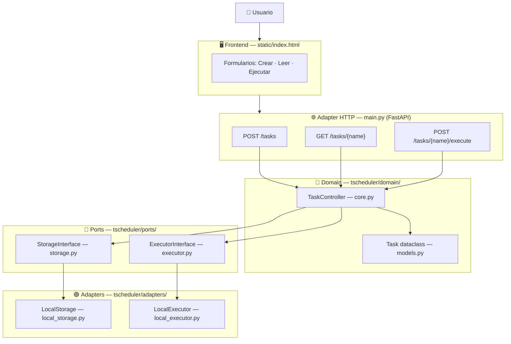
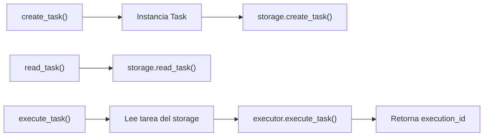
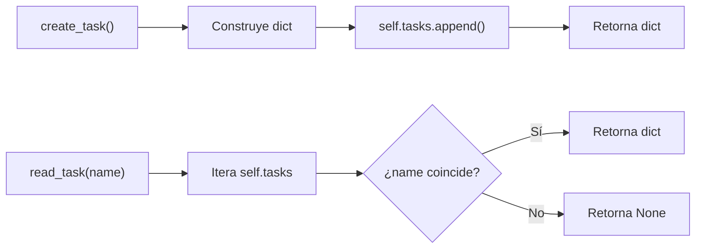
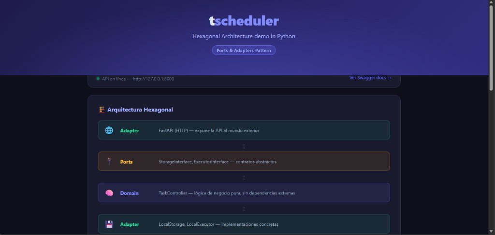
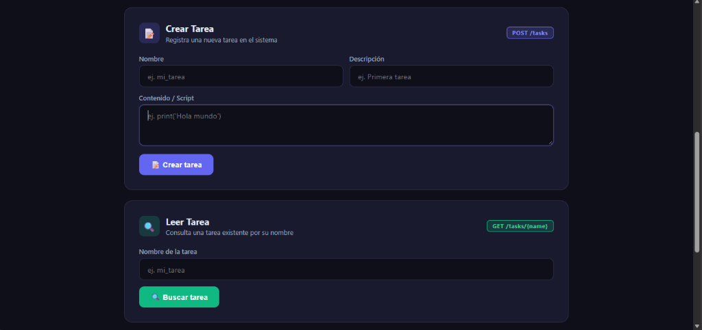
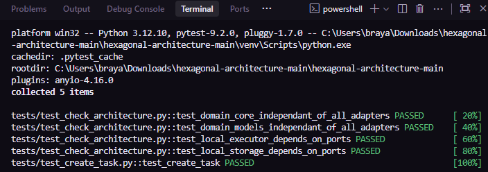

# Documentación del Proyecto — tscheduler
**Arquitectura Hexagonal (Ports & Adapters) implementada en Python**

---

## 1. Visión General

`tscheduler` es una aplicación desarrollada en Python que implementa el patrón de **Arquitectura Hexagonal** (también conocido como *Ports & Adapters*). El objetivo es demostrar cómo separar la lógica de negocio de los componentes externos, haciendo el sistema más flexible, testeable y mantenible.

La aplicación permite:
- **Crear** una tarea
- **Leer** una tarea
- **Ejecutar** una tarea



---

## 2. Estructura del Proyecto

```
hexagonal-architecture-main/
│
├── main.py                        ← Adapter HTTP (FastAPI)
├── configurator.py                ← Modo consola
│
├── static/
│   └── index.html                 ← Frontend web
│
├── tscheduler/
│   ├── domain/                    ← Núcleo (lógica de negocio)
│   │   ├── core.py
│   │   └── models.py
│   ├── ports/                     ← Contratos (interfaces)
│   │   ├── storage.py
│   │   └── executor.py
│   └── adapters/                  ← Implementaciones concretas
│       ├── local_storage.py
│       └── local_executor.py
│
├── tests/
│   ├── test_create_task.py
│   └── test_check_architecture.py
│
└── .github/workflows/
    ├── tscheduler.yml
    └── check-architecture.yml
```

---

## 3. Capa Domain — Lógica de Negocio

La capa Domain es el núcleo de la aplicación. No depende de ningún framework ni componente externo.

### 3.1 Modelo de datos — `tscheduler/domain/models.py`

```python
from dataclasses import dataclass


@dataclass
class Task:
    name: str
    description: str
    data: str
```

| Campo | Tipo | Descripción |
|---|---|---|
| `name` | `str` | Identificador único de la tarea |
| `description` | `str` | Descripción legible de la tarea |
| `data` | `str` | Contenido o script a ejecutar |

---

### 3.2 Controlador de negocio — `tscheduler/domain/core.py`

```python
from tscheduler.domain.models import Task
from tscheduler.ports.executor import ExecutorInterface
from tscheduler.ports.storage import StorageInterface


class TaskController:

    def __init__(
        self,
        storage: StorageInterface | None = None,
        executor: ExecutorInterface | None = None,
    ):
        self.storage = storage
        self.executor = executor

    def create_task(self, name: str, description: str, data: str) -> dict:
        task = Task(name=name, description=description, data=data)
        created_task = self.storage.create_task(
            name=task.name, description=task.description, data=task.data
        )
        return created_task

    def read_task(self, name: str) -> dict | None:
        return self.storage.read_task(name=name)

    def execute_task(self, name: str) -> str:
        task = self.storage.read_task(name=name)
        task = Task(**task)
        execution_id = self.executor.execute_task(data=task.data)
        return execution_id
```

`TaskController` recibe las interfaces `StorageInterface` y `ExecutorInterface` mediante **inyección de dependencias por constructor**, lo que le permite operar sin conocer las implementaciones concretas.



---

## 4. Capa Ports — Contratos

Los Ports son clases abstractas que definen los contratos que deben cumplir los adaptadores. Actúan como la frontera entre el dominio y el exterior.

### 4.1 Contrato de almacenamiento — `tscheduler/ports/storage.py`

```python
from abc import ABC, abstractmethod


class StorageInterface(ABC):
    """Storage interface that should be implemented by our storage systems"""

    @abstractmethod
    def create_task(self, name: str, description: str, data: str) -> dict:
        raise NotImplementedError

    @abstractmethod
    def read_task(self, name) -> dict | None:
        raise NotImplementedError
```

| Método | Parámetros | Retorno | Descripción |
|---|---|---|---|
| `create_task()` | name, description, data | `dict` | Persiste una nueva tarea |
| `read_task()` | name | `dict \| None` | Recupera una tarea por nombre |

---

### 4.2 Contrato de ejecución — `tscheduler/ports/executor.py`

```python
from abc import ABC, abstractmethod


class ExecutorInterface(ABC):
    """Executor interface that should be implemented by our executors"""

    @abstractmethod
    def execute_task(self, data: str) -> str:
        raise NotImplementedError
```

| Método | Parámetros | Retorno | Descripción |
|---|---|---|---|
| `execute_task()` | data: str | `str` | Lanza la ejecución y retorna un ID |

---

## 5. Capa Adapters — Implementaciones Concretas

Los Adapters son los componentes externos que implementan los contratos definidos por los Ports.

### 5.1 Almacenamiento local — `tscheduler/adapters/local_storage.py`

```python
from tscheduler.ports.storage import StorageInterface


class LocalStorage(StorageInterface):
    def __init__(self):
        self.tasks = []

    def create_task(self, name: str, description: str, data: str) -> dict:
        task = {"name": name, "description": description, "data": data}
        self.tasks.append(task)
        return task

    def read_task(self, name: str) -> dict | None:
        for item in self.tasks:
            if item.get("name") == name:
                return item
```

Almacena las tareas en memoria (lista de Python). En un entorno de producción esta clase podría ser reemplazada por una implementación que conecte con una base de datos real sin modificar el Domain.



---

### 5.2 Ejecutor local — `tscheduler/adapters/local_executor.py`

```python
import uuid

from tscheduler.ports.executor import ExecutorInterface


class LocalExecutor(ExecutorInterface):

    def execute_task(self, data: str) -> str:
        print("Executing:", data)
        execution_id = uuid.uuid4().hex
        return execution_id
```

Simula la ejecución de una tarea de forma local, generando un identificador único con `uuid`. En producción podría lanzar jobs en la nube o procesar colas de trabajo.

---

## 6. Adapter HTTP — FastAPI (`main.py`)

FastAPI actúa como un adaptador más: expone la aplicación al exterior como una API REST. El `TaskController` no tiene conocimiento de su existencia.

```python
from fastapi import FastAPI
from fastapi.staticfiles import StaticFiles
from fastapi.responses import FileResponse
from pydantic import BaseModel

from tscheduler.adapters.local_executor import LocalExecutor
from tscheduler.adapters.local_storage import LocalStorage
from tscheduler.domain.core import TaskController

app = FastAPI()
app.mount("/static", StaticFiles(directory="static"), name="static")

class Task(BaseModel):
    name: str
    description: str
    data: str

controller = TaskController(storage=LocalStorage(), executor=LocalExecutor())

@app.get("/")
def root():
    return FileResponse("static/index.html")

@app.post("/tasks")
def create_task(task: Task):
    return controller.create_task(name=task.name, description=task.description, data=task.data)

@app.get("/tasks/{task_name}")
def read_task(task_name: str):
    return controller.read_task(name=task_name)

@app.post("/tasks/{task_name}/execute")
def execute_task(task_name: str):
    execution_id = controller.execute_task(name=task_name)
    return {"execution_id": execution_id}
```

### Endpoints de la API

| Método | Ruta | Descripción | Body requerido |
|---|---|---|---|
| `GET` | `/` | Sirve el frontend HTML | — |
| `POST` | `/tasks` | Crear una tarea | `{name, description, data}` |
| `GET` | `/tasks/{name}` | Leer una tarea | — |
| `POST` | `/tasks/{name}/execute` | Ejecutar una tarea | — |

---

## 7. Frontend — `static/index.html`

Interfaz web que se sirve directamente desde FastAPI y se conecta a la API mediante `fetch()`.

### Vista principal — Header y diagrama de arquitectura



La pantalla principal muestra el nombre de la aplicación, el estado de la API en tiempo real y un diagrama visual interactivo con las capas de la Arquitectura Hexagonal (Adapter, Ports, Domain).

### Formularios de operaciones



Contiene tres secciones funcionales:

**Crear Tarea** — formulario con campos `name`, `description` y `data`. Envía `POST /tasks`.

**Leer Tarea** — campo de búsqueda por nombre. Envía `GET /tasks/{name}`.

**Ejecutar Tarea** — campo de nombre. Envía `POST /tasks/{name}/execute` y muestra el `execution_id` generado.

URLs de acceso:
- Frontend: `http://127.0.0.1:8000`
- Documentación Swagger: `http://127.0.0.1:8000/docs`

---

## 8. Tests

### 8.1 Unit Test — `tests/test_create_task.py`

```python
from tscheduler.adapters.local_storage import LocalStorage
from tscheduler.domain.core import TaskController


def test_create_task():
    controller = TaskController(storage=LocalStorage())
    result = controller.create_task(
        name="my_task", description="First task", data="Task Content Script"
    )
    assert result.get("name") == "my_task"
```

Verifica que el controlador crea una tarea correctamente. No requiere servidor ni base de datos: se inyecta directamente `LocalStorage`.

---

### 8.2 Fitness Functions — `tests/test_check_architecture.py`

```python
import ast


def is_dependant(source_file: str, destination: str):
    with open(source_file, "r") as f:
        source = ast.parse(f.read())
        for statement in source.body:
            if isinstance(statement, ast.Import) or isinstance(statement, ast.ImportFrom):
                if hasattr(statement, "module") and destination in statement.module:
                    return True
                if any(name for name in statement.names if destination in name.name):
                    return True
    return False


def test_domain_core_independant_of_all_adapters():
    assert is_dependant("./tscheduler/domain/core.py", "adapters") is False


def test_domain_models_independant_of_all_adapters():
    assert is_dependant("./tscheduler/domain/models.py", "adapters") is False


def test_local_executor_depends_on_ports():
    assert is_dependant("./tscheduler/adapters/local_executor.py", "ports") is True


def test_local_storage_depends_on_ports():
    assert is_dependant("./tscheduler/adapters/local_storage.py", "ports") is True
```

Las fitness functions analizan el AST (árbol de sintaxis abstracta) del código fuente para verificar automáticamente que las reglas de la arquitectura no se violen.

### 8.3 Resultado de ejecución



---

## 9. CI/CD — GitHub Actions

Al hacer push a la rama `main` se ejecutan automáticamente dos workflows:

| Workflow | Archivo | Qué hace |
|---|---|---|
| Unit Tests | `tscheduler.yml` | Ejecuta `test_create_task` |
| Architecture Check | `check-architecture.yml` | Ejecuta las fitness functions |

---

## 10. Resumen de reglas de la Arquitectura

| Regla | Resultado |
|---|---|
| El Domain no importa Adapters | ✅ Verificado por fitness functions |
| El Domain no importa frameworks externos | ✅ Solo stdlib de Python |
| Los Adapters implementan los Ports | ✅ Heredan de clases ABC |
| Se puede reemplazar un Adapter sin modificar el Domain | ✅ Por diseño del patrón |
| Los tests no requieren infraestructura real | ✅ Usando `LocalStorage` directamente |
| La API está expuesta como un Adapter más | ✅ FastAPI en `main.py` |
